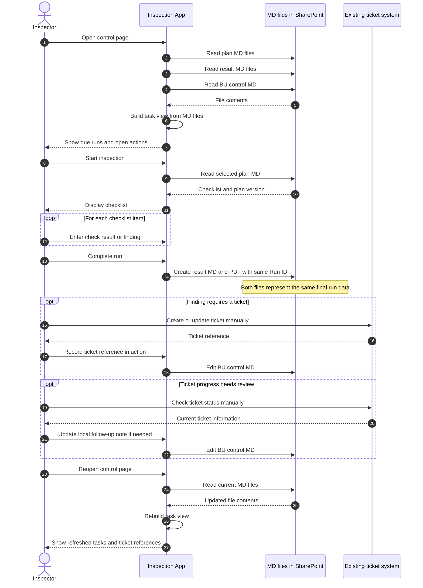

# Konzept: Prueflisten-App mit dateibasierter Steuerung

**Status:** Zielkonzept, fachlich und technisch zu validieren  
**Zielgruppe:** Projektteam, App-Verantwortliche, Pruefverantwortliche und Erstanwender  
**Stand:** 2026-11-05

## Executive Summary

Die Prueflisten-App bleibt eine Anwendung zur Anzeige und Bearbeitung von Markdown-Dateien (MD); sie besitzt keine eigene Datenbank. SharePoint ist der fuehrende Ablageort, Microsoft Teams dient als Einstieg. Die Synchronisation der Dateien erfolgt ueber SharePoint beziehungsweise OneDrive und nicht durch einen kuenstlichen Intelligenz (KI)-Agenten.

Das fachliche Modell trennt drei MD-Artefakttypen: den freigegebenen Pruefplan, die Ergebnisdatei je Prueflauf sowie eine Steuerungsdatei je Business-Unit (BU). Die App soll beim expliziten Abschluss eines Prueflaufs parallel eine Ergebnis-MD und ein PDF mit derselben Lauf-ID erzeugen. Die Steuerungsdatei verknuepft Plaene, Ergebnisse und offene Massnahmen. Ein vorhandenes externes Ticketsystem bleibt ohne digitale Schnittstelle; Ticketreferenzen werden manuell dokumentiert.

## Ziel und Geltungsbereich

Das Konzept beschreibt den Zielablauf fuer externe Prueflisten, freigegebene digitale Pruefplaene, wiederkehrende Prueflaeufe, Ergebnisnachweise und offene Massnahmen. Es soll Erstanwendern einen klaren Einstieg geben und gleichzeitig nachvollziehbare Ablage und Verknuepfung der MD-Dateien sicherstellen.

**Im Geltungsbereich:**

- Eingang und fachliche Sichtung externer Listen.
- Optionale Prueffristen in Pruefplan-MD-Dateien.
- Durchfuehrung und Abschluss eines Prueflaufs in der App.
- Paralleler Export der Ergebnis-MD und des Ergebnis-PDF.
- Steuerungsuebersicht fuer Prueflaeufe und offene Massnahmen.
- Manuelle Referenzierung von Tickets im Bestandssystem.
- Ablage, Versionierung und Aufbewahrung in SharePoint.

**Nicht im Geltungsbereich:**

- Eine separate Datenbank oder ein eigenstaendiger App-Datenspeicher.
- Eine digitale Ticketsystem-Schnittstelle.
- Eine automatische, ungepruefte Uebernahme externer Listen als gueltige Pruefplaene.
- Die Ableitung nicht bestaetigter Prueffristen aus der DGUV-Kennzeichnung.
- Eine Zusage der Revisionssicherheit allein durch PDF-Export.

## Ist-Stand, Annahmen und offene Punkte

### Bestaetigter Ist-Stand aus dem Dialog

- Die App zeigt MD-Dateien an und ermoeglicht ihre Bearbeitung; sie hat keine eigene Storage- beziehungsweise Datenbankfunktion.
- Die App kann PDF erzeugen.
- Ein Prueflauf endet mit einer MD-Ergebnisliste.
- SharePoint und Teams stehen als Arbeitsplattformen zur Verfuegung.
- Das externe Ticketsystem hat voraussichtlich keine digitale Schnittstelle zur App.
- In der Quellpruefliste stehen `T`, `W`, `M` und `DGUV` fuer taegliche, woechentliche, monatliche beziehungsweise DGUV-Pruefungen ohne in der Liste angegebenes genaues Intervall.

### Annahmen fuer das Zielkonzept

- SharePoint wird als fuehrender Speicherort fuer Plan-, Ergebnis- und Steuerungsdateien festgelegt.
- Teams verlinkt auf die SharePoint-Bibliothek und die App, ohne eine zweite Dateiablage als fuehrend einzurichten.
- Der Pruefer startet und beendet einen Lauf bewusst in der App; der Abschluss ist der Ausloeser fuer die Ergebnisdateien.
- Ein Pruefplan erhaelt eine stabile Plan-ID und Version; ein einzelner Prueflauf erhaelt eine eindeutige Lauf-ID.
- Die BU-Steuerungsdatei ist die fuehrende manuell bearbeitete Uebersicht fuer offene Massnahmen.

### Vor Umsetzung zu klaeren

- Greift die App direkt auf SharePoint zu oder arbeitet sie mit einer synchronisierten OneDrive-Bibliothek?
- Welche SharePoint-Berechtigungen gelten fuer Eingang, Freigabe, Pruefung und Archiv?
- Welche Organisationseinheit beziehungsweise welches Verfahren gibt Pruefplaene frei?
- Wie werden Prueffristen fachlich festgelegt, insbesondere bei DGUV-Pruefungen?
- Welche SharePoint-Aufbewahrungs-, Versions- oder Records-Management-Regeln sind verbindlich?
- Welche genaue Laufzeit- und Faelligkeitsregel gilt fuer taegliche, woechentliche und monatliche Pruefungen?

## Fachliches Modell

### 1. Pruefplan-MD

Der Pruefplan beschreibt, **was** zu pruefen ist: Position, Material, Soll-Menge, optionale Prueffrist und gegebenenfalls fachliche Hinweise. Er ist der freigegebene Soll-Stand und wird nicht mit den Ergebnissen eines einzelnen Prueflaufs ueberschrieben.

Die Prueffrist wird als optionales Feld ergaenzt. Bestehende MD-Dateien ohne das Feld muessen weiterhin lesbar bleiben. Eine leere Angabe bedeutet **„noch nicht bewertet oder nicht gepflegt“**, nicht „keine Pruefung erforderlich“.

| Kennzeichnung in der Quelle | Bedeutung laut Dialog | Behandlung im Konzept |
|---|---|---|
| `T` | taeglich | Als Rhythmus uebernehmen; konkrete Faelligkeitsregel fachlich festlegen |
| `W` | woechentlich | Als Rhythmus uebernehmen; konkrete Faelligkeitsregel fachlich festlegen |
| `M` | monatlich | Als Rhythmus uebernehmen; konkrete Faelligkeitsregel fachlich festlegen |
| `DGUV` | DGUV-Pruefung, Intervall in der Liste nicht angegeben | Pruefart kennzeichnen; Intervall nicht erraten, sondern separat klaeren |

Die App muss die bestehende MD-Tabellenstruktur rueckwaertskompatibel lesen. Wenn das Tabellenformat erweitert wird, sollte die optionale Spalte an das Ende angehaengt werden. Die konkrete Spaltenposition und Parser-Kompatibilitaet sind vor Umsetzung zu testen.

### 2. Ergebnis-MD und Ergebnis-PDF je Prueflauf

Jeder abgeschlossene Prueflauf bekommt eine eindeutige Lauf-ID. Die App erzeugt aus demselben finalen Pruefstand zwei zusammengehoerige Dateien:

- **Ergebnis-MD:** maschinenlesbarer und abgleichbarer Nachweis des Prueflaufs.
- **Ergebnis-PDF:** lesbarer Export zum Teilen und Drucken.

Beide Dateien muessen mindestens dieselbe Lauf-ID, BU-ID, Plan-ID und Planversion sowie Pruefdatum und Pruefer tragen. Abgeschlossene Ergebnisse werden im Arbeitsablauf nicht stillschweigend ueberschrieben. Erforderliche Korrekturen muessen als nachvollziehbare Aenderung oder Ergaenzung erfolgen.

### 3. Steuerungs-MD je BU

Die Steuerungsdatei ist das verbindende Uebersichts- und Massnahmenregister, keine weitere Ergebnisliste. Sie fuehrt je Plan letzte und naechste Prueflaeufe, offene Massnahmen, Verantwortlichkeiten, Zieltermine und Verweise auf die zugehoerigen Ergebnisdateien.

Eine Massnahme referenziert den Befund ueber Lauf-ID und Pruefposition. Der Massnahmenstatus wird an einer Stelle gepflegt. Bei externen Tickets werden Ticket-ID, Ticketsystem und Datum des letzten manuellen Abgleichs als Referenz dokumentiert. Das externe Ticketsystem bleibt fuer seinen Ticketstatus massgeblich; die App behauptet ohne Schnittstelle keinen automatisch aktuellen Status.

## Rollen und Verantwortung

| Rolle | Verantwortung |
|---|---|
| Pruefplan-Verantwortlicher | Quellliste sichten, Plan entwerfen, Prueffristen klaeren und Freigabe sicherstellen |
| Pruefer | Aktiven Plan auswaehlen, Pruefung durchfuehren, Ergebnis erfassen und Lauf abschliessen |
| Massnahmenverantwortlicher | Zugewiesene Massnahme bearbeiten, Nachweis bereitstellen und Steuerungsdatei aktualisieren |
| SharePoint-/Teams-Administration | Berechtigungen, Versionierung, Aufbewahrung und Wiederherstellung konfigurieren |
| App-Verantwortlicher | Parser, MD-Bearbeitung, Export und Fehlerbehandlung testen und betreiben |

## Ablagekonzept in SharePoint und Teams

SharePoint ist der eine fuehrende Speicherort. Teams dient als Navigation beziehungsweise Registerkarte zur Bibliothek und App. Dateien sollen nicht zusaetzlich als Chat- oder Kanal-Anhaenge zu einer parallelen, schwer nachvollziehbaren Ablage werden.

```text
Pruefmanagement/
  00_Eingang/
    Externe_Prueflisten/
  10_Freigegebene_Plaene/
    20_Prueflaeufe/
      <Plan-ID>/
        <Jahr>/
          <Plan-ID>__<Datum>__<Lauf-ID>_Ergebnis.md
          <Plan-ID>__<Datum>__<Lauf-ID>_Ergebnis.pdf
  30_Steuerung/
    <BU-ID>_steuerung.md
  90_Quellenarchiv/
    Externe_Prueflisten/
```

`00_Eingang` ist eine Sichtungszone, kein aktiver Planbestand. Externe Originale bleiben unveraendert. Nach fachlicher Pruefung entsteht ein Planentwurf; erst nach Freigabe wird dieser in `10_Freigegebene_Plaene` bereitgestellt. Teams verlinkt auf die Bibliothek. Falls die App einen Dateisystempfad benoetigt, kann eine synchronisierte OneDrive-Bibliothek ein Zugriffsweg sein, muss aber praktisch auf Synchronisationsverzoegerungen und Konfliktkopien getestet werden.

## Soll-Ablauf

1. **Eingang:** Eine externe Pruefliste wird in `00_Eingang` abgelegt; das Original bleibt erhalten.
2. **Sichtung und Freigabe:** Eine verantwortliche Person uebernimmt fachlich bestaetigte Positionen in einen versionierten Pruefplan und klaert unbekannte Prueffristen.
3. **Prueflauf starten:** Der Pruefer waehlt in der App die BU und den aktiven, freigegebenen Plan.
4. **Pruefung dokumentieren:** Der Pruefer erfasst je Position das Ergebnis und gegebenenfalls einen Befund.
5. **Lauf abschliessen:** Die explizite App-Aktion `Prueflauf abschliessen` erzeugt Ergebnis-MD und PDF parallel aus demselben finalen Stand.
6. **Ergebnisse ablegen und verknuepfen:** Beide Dateien werden mit derselben Lauf-ID unter `20_Prueflaeufe` abgelegt. Erst nach erfolgreichem Schreiben und Pruefen der Dateien wird die Steuerungs-MD aktualisiert.
7. **Massnahmen nachhalten:** Bestaetigte Folgeaufgaben werden in der Steuerungs-MD verknuepft. Ein externes Ticket wird bei Bedarf manuell angelegt und als Referenz eingetragen.
8. **Naechsten Lauf vorbereiten:** Die App liest die aktuellen Dateien erneut ein. Der naechste Lauf folgt dem aktiven Plan; offene Massnahmen werden in der Steuerungsansicht weitergefuehrt.

Ein KI-Agent ist fuer die Synchronisation nicht erforderlich. SharePoint beziehungsweise OneDrive synchronisiert Dateien. Die App-Funktion zum Abschliessen eines Laufs ist der fachliche Ausloeser fuer das Schreiben der Ergebnisdateien und die Aktualisierung der Steuerungs-MD. Eine automatische Verarbeitung neuer externer Listen ist nicht Teil des Soll-Ablaufs ohne menschliche Sichtung und Freigabe.

## Aufgabenuebersicht in der App

Als Zielbild bekommt die App eine Steuerseite mit zwei getrennten Aufgabenbereichen:

- **Prueflaeufe:** bald faellig, faellig oder ueberfaellig; mit Plan, Rhythmus, letztem Lauf und Einstieg zum Starten.
- **Massnahmen:** offen, in Bearbeitung oder zur Verifizierung; mit Befundlink, Verantwortlichem, Zieltermin und optionaler manueller Ticketreferenz.

Die Steuerseite ist eine aus den MD-Dateien abgeleitete Ansicht, keine weitere Datenbank. Faelligkeiten duerfen nur berechnet werden, wenn Rhythmus und Berechnungsregel festgelegt sind. Bei ungeklaertem DGUV-Intervall wird ein Klaerungshinweis gezeigt, kein geschaetztes Datum.

## UML-Ablauf

Die folgende Sequenz zeigt das Zielbild: Die App liest und bearbeitet MD-Dateien in SharePoint, erzeugt beim Abschluss die Ergebnisdateien und fuehrt Ticketreferenzen ohne digitale Schnittstelle.



**Hinweis:** Das Diagramm ist eine KI-generierte Arbeitsdarstellung. Begriffe, Speicherpfade und tatsaechliches App-Verhalten muessen vor operativer Nutzung fachlich und technisch validiert werden.

## Revisions-, Versions- und Konfliktbehandlung

- PDF-Export oder SharePoint-Versionierung allein belegen keine Revisionssicherheit. Aufbewahrung, Records Management, Berechtigungen und Aenderungsprotokolle muessen mit der zustaendigen Administration abgestimmt werden.
- Die Unveraendertheit abgeschlossener Ergebnisdateien ist zunaechst eine Prozessregel. Wenn technische Unveraenderbarkeit erforderlich ist, muss sie durch passende SharePoint-Aufbewahrungsfunktionen oder ein freigegebenes Records-Management-Verfahren abgesichert werden.
- Gleichzeitige Bearbeitung der Steuerungs-MD kann zu Konflikten fuehren. Bis ein kollaboratives Verfahren besteht, sollte nur eine Person gleichzeitig diese Datei aendern.
- Bei einem Fehler waehrend des Exports darf die App keinen erfolgreichen Lauf ausweisen. Die Steuerungs-MD wird erst aktualisiert, nachdem MD und PDF erfolgreich geschrieben und geprueft wurden.
- Lauf-ID, Plan-ID und Planversion muessen in Steuerungs- und Ergebnisdateien gleich geschrieben sein. Verweise auf nicht vorhandene Dateien muessen erkennbar sein.

## Umsetzungsvorschlag / Backlog

1. **SharePoint-Zugriff klaeren:** Direkter SharePoint-Zugriff oder OneDrive-Synchronisation, Rechte, Konflikte, Versionierung und Wiederherstellung praktisch pruefen.
2. **Ablage und Metadaten festlegen:** Bibliotheksstruktur, BU-ID, Plan-ID, Planversion und Lauf-ID verbindlich definieren.
3. **Eingangsprozess ergaenzen:** Externe Listen erfassen, Originale bewahren, Sichtung und Freigabe nachvollziehbar machen.
4. **Prueffrist im MD einfuehren:** Optionales Feld, rueckwaertskompatibler Parser, Eingabevalidierung und Behandlung ungeklaerter DGUV-Intervalle.
5. **Steuerseite aufbauen:** Prueflaeufe und Massnahmen getrennt aus MD-Dateien aggregieren und verlinken.
6. **Laufabschluss entwickeln:** Expliziter Abschluss, paralleler MD-/PDF-Export mit gemeinsamer Lauf-ID, Fehler- und Wiederanlaufbehandlung.
7. **Massnahmen und Ticketreferenzen ergaenzen:** Befundverknuepfung, Verantwortlichkeit, Zieltermin und manuell gepflegte externe Ticketkennung.
8. **Aufbewahrung absichern:** SharePoint-Versionierung, Retention beziehungsweise Records Management und Berechtigungen mit Administration festlegen.

## Abnahmekriterien fuer das Zielbild

- Externe Originale werden nicht ueberschrieben oder ungeprueft zu aktiven Plaenen.
- Ein freigegebener Plan ist eindeutig ueber BU-ID, Plan-ID und Version identifizierbar.
- Bestehende MD-Dateien ohne Prueffrist bleiben lesbar.
- Ein abgeschlossener Prueflauf erzeugt eine Ergebnis-MD und ein PDF mit gleicher Lauf-ID und gleichem finalem Datenstand.
- Die Steuerungsseite zeigt Prueflaeufe und Massnahmen getrennt und verlinkt auf die Quelldateien.
- Das Bestandsticketsystem wird nicht als integriert dargestellt; Ticketreferenzen werden manuell nachgehalten.
- Ungeklaerte Intervalle und fehlende Nachweise werden sichtbar als offen ausgewiesen, nicht automatisch als gueltig interpretiert.
- Der SharePoint-Ablage- und Aufbewahrungsweg ist mit der Administration abgestimmt.

## Projektgrafik

Die Einsteigeruebersicht liegt separat unter [prueflisten-app-projektuebersicht.svg](prueflisten-app-projektuebersicht.svg).